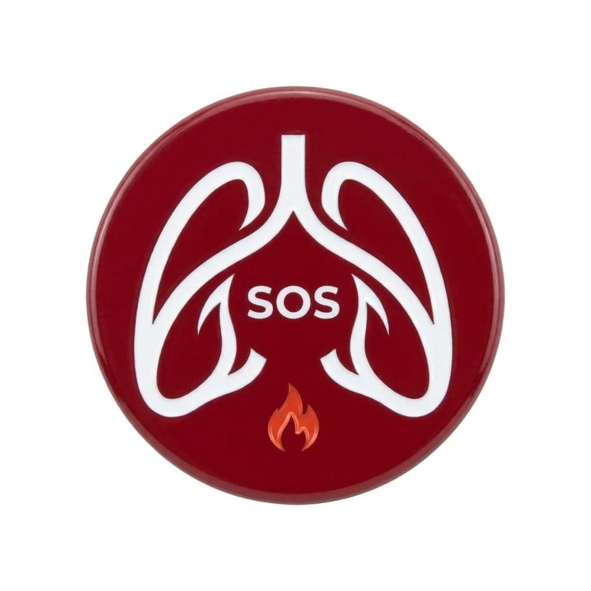
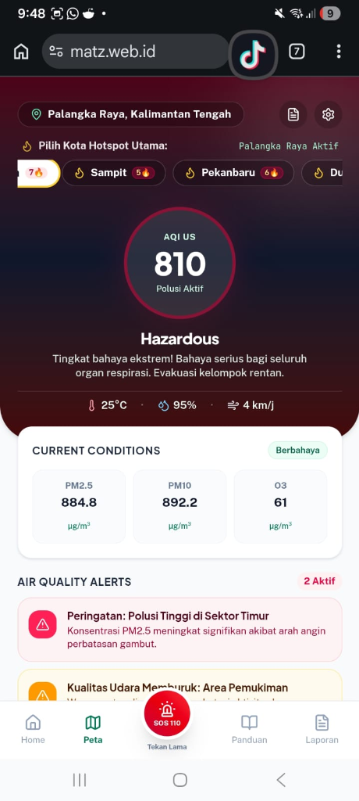
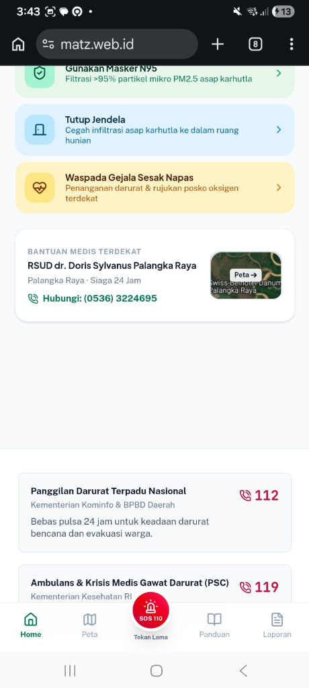

<div align="center">
  
  <h1>SIAGA ASAP</h1>
  <p><strong>Platform Pemantau Kualitas Udara Real-Time, Deteksi Titik Api Karhutla, dan Sistem Tanggap Darurat Respirasi Nasional</strong></p>
  <p>Dikembangkan khusus untuk perlindungan masyarakat terdampak bencana kebakaran hutan dan lahan (Karhutla) di Indonesia.</p>
</div>

---

## 1. Latar Belakang & Urgensi Solusi

Kebakaran Hutan dan Lahan (Karhutla) di lahan gambut Sumatera dan Kalimantan merupakan bencana tahunan berulang di Indonesia yang menimbulkan kabut asap pekat lintas batas (*transboundary haze*). Partikulat mikro PM2.5 (partikel berdiameter <= 2.5 mikron) dan gas beracun (CO, NO2, SO2, O3) yang dihasilkan dari pembakaran bahan organik gambut menembus hingga ke alveolus paru-paru dan pembuluh darah, memicu lonjakan kasus Infeksi Saluran Pernapasan Akut (ISPA), asma, bronkitis, serta ancaman gagal napas pada bayi, lansia, dan penderita komorbiditas respirasi.

Kendala nyata di lapangan selama masa krisis:
- Informasi kualitas udara sering tersebar di berbagai stasiun pemantau yang tidak terintegrasi dan sulit diakses masyarakat awam.
- Peta sebaran titik api satelit umumnya disajikan dalam format mentah GIS yang berat dan membingungkan untuk perangkat mobile warga di daerah pedalaman atau sinyal terbatas.
- Ketiadaan kanal pelaporan warga yang cepat dan terverifikasi untuk memanggil pemadam sebelum kebakaran lahan gambut menjalar lebih luas.
- Keterlambatan masyarakat dalam menemukan Rumah Sakit atau Puskesmas rujukan paru yang memiliki fasilitas tabung oksigen dan ruang bersih udara.

**SIAGA ASAP** dibangun sebagai platform respon cepat terpadu (*Rapid Disaster & Public Health Surveillance Platform*) yang menggabungkan citra satelit NASA, data atmosfer Copernicus CAMS, sensor cuaca OpenWeather, standar Indeks Standar Pencemar Udara (ISPU) Permen LHK No. 14 Tahun 2020, serta panduan medis Kemenkes RI ke dalam antarmuka modern yang adaptif di ponsel, tablet, maupun layar desktop.

---

## 2. Tangkapan Layar Antarmuka (UI Walkthrough)

<div align="center">
  <table>
    <tr>
      <td align="center" width="50%">
        <br />
        <em>Tampilan Mobile: Radial AQI Gauge, Cuaca Mikro, dan Pemilih Hotspot Gambut</em>
      </td>
      <td align="center" width="50%">
        <br />
        <em>Tampilan Mobile: Protokol Perlindungan, Peta Satelit Tersemat, dan Hotline Medis 24 Jam</em>
      </td>
    </tr>
  </table>
</div>

---

## 3. Fitur Utama Sistem

### A. Dual Responsive Experience (Deteksi Display Otomatis)
Aplikasi mendeteksi resolusi perangkat secara alami (*pure responsive CSS architecture*) tanpa simulasi atau peralihan manual:
- **Mode Mobile (< 768px):** Dirancang ergonomis untuk penggunaan satu tangan di lapangan (*thumb-friendly*). Dilengkapi curved header dengan dynamic gradient berbasis level polusi, radial AQI gauge, peta interaktif tersemat langsung di halaman utama tanpa white space kosong, banner lapor cepat warga, serta bottom navigation bar 5-kolom dengan tombol SOS 110/112 tepat di sumbu tengah (50%).
- **Mode Desktop & Tablet (>= 768px):** Berubah menjadi Command Center 12-kolom padat informasi (*zero wasted whitespace*). Menampilkan pita pemilih hotspot per provinsi, ringkasan polutan real-time (PM2.5, PM10, SO2, NO2, O3, CO), peta GIS MapLibre multi-layer, direktori faskes rujukan paru se-Indonesia, dan kalkulator risiko kesehatan individual.

### B. Pemantau Kualitas Udara Real-Time & Rumus Standar ISPU / AQI US
- Mendukung pemantauan titik-titik hotspot karhutla utama di seluruh pulau rawan (Palangka Raya, Sampit, Pekanbaru, Dumai, Palembang, Jambi, Pontianak, Banjarmasin, Tomohon, Manado, hingga DKI Jakarta).
- Menghitung nilai AQI US berdasarkan konsentrasi PM2.5 menggunakan formula piecewise linear EPA dengan ceiling cap standar 500 (*Hazardous*).
- Menampilkan konversi kategori resmi ISPU Indonesia: Baik (0-50), Sedang (51-100), Tidak Sehat (101-200), Sangat Tidak Sehat (201-300), dan Berbahaya (301-500).

### C. Peta Terpadu Satelit & Hotspot Karhutla (MapLibre GL JS)
- Layer citra satelit Google Hybrid, Google Roads, dan Esri Dark Canvas berkecepatan tinggi.
- Plotting titik panas (*thermal hotspots*) aktif berbasis data NASA VIIRS 375m dengan tingkat akurasi tinggi dan visualisasi radius dampak asap.
- Plotting fasilitas kesehatan (RSUD, RS Paru, Posko Oksigen) terverifikasi di seluruh provinsi dengan kontak IGD 24 jam yang dapat ditelepon langsung (*click-to-call*).

### D. Sistem Tanggap Darurat & SOS Hold-to-Call
- Tombol SOS tengah pada navigasi mobile dilengkapi teknologi *Hold-to-Activate* (tekan tahan 1 detik dengan feedback progress melingkar) untuk mencegah pemicuan panggilan darurat yang tidak disengaja (*accidental touch prevention*).
- Mengarahkan warga langsung ke saluran darurat nasional 110 (Kepolisian), 112 (BPBD/Bencana), dan 119 (Krisis Medis/Ambulans PSC).

### E. Posko Pengaduan & Pelaporan Kabut Asap Warga
- Formulir pelaporan warga interaktif dengan deteksi geolokasi GPS presisi tinggi (lintang/bujur), pemilihan tingkat kepekatan asap (Sedang, Pekat, Jarak Pandang < 50m, Titik Api Menyala), serta estimasi radius sebaran untuk diteruskan ke satgas penanggulangan karhutla.

### F. Protokol Perlindungan Diri & Kalkulator Risiko Medis
- Panduan teknis penggunaan masker respirator N95 sesuai rekomendasi Kementerian Kesehatan RI dan Perhimpunan Dokter Paru Indonesia (PDPI).
- Prosedur pembuatan *Clean Air Room* (ruang isolasi udara bersih rumah tangga) saat darurat asap pekat.
- Kalkulator risiko kesehatan personal berdasarkan usia, status kehamilan, riwayat penyakit (asma, PPOK, jantung), dan durasi paparan luar ruangan.

---

## 4. Arsitektur Teknologi & Third-Party Libraries

| Kategori | Teknologi / Library | Versi | Tujuan & Penggunaan |
| :--- | :--- | :--- | :--- |
| **Frontend Framework** | React | 19.x | Library komponen UI modern dengan reactive state management |
| **Language** | TypeScript | 5.8 | Penjaminan type-safety pada skema data polusi dan geo-koordinat |
| **Build Tool & Bundler** | Vite | 6.x / 8.x | Kompilasi ultra-cepat, ESM module replacement, dan production bundling |
| **Styling & Design System** | Tailwind CSS | 4.x | Utility-first styling, responsive fluid grid, dark canvas palette |
| **GIS & Mapping Engine** | MapLibre GL JS | 4.7.1 | Render peta vektor dan raster WebGL interaktif multi-layer |
| **Iconography** | Lucide React | Latest | Set ikon SVG profesional terbuka (standar zero-emoji) |
| **Unit Testing** | Node.js Test Runner / Vitest | Built-in | Verifikasi formula matematika AQI, kalkulator risiko, dan status ISPU |

---

## 5. Sumber Data & API Eksternal

1. **OpenWeather Air Pollution API:**
   - Menyediakan data real-time konsentrasi polutan partikulat (PM2.5, PM10) dan gas (CO, NO2, SO2, O3).
   - Parameter meteorologi: suhu permukaan, kelembapan relatif, kecepatan angin, dan arah mata angin untuk analisis dispersi asap.
2. **Copernicus Atmosphere Monitoring Service (CAMS):**
   - Referensi data komposisi kimiawi atmosfer global dan pergerakan aerosol kabut asap lintas pulau.
3. **NASA FIRMS (Fire Information for Resource Management System):**
   - Basis data koordinat titik panas (*active fire / thermal anomaly*) sensor VIIRS S-NPP dan NOAA-20 dengan resolusi spasial 375 meter.
4. **Kementerian Lingkungan Hidup dan Kehutanan (KLHK) RI:**
   - Standar penghitungan dan ambang batas Indeks Standar Pencemar Udara (ISPU) berdasarkan Permen LHK No. 14 Tahun 2020.
5. **Kementerian Kesehatan RI & PDPI:**
   - Protokol triase medis darurat kabut asap, standar filtrasi partikulat masker N95, serta direktori kontak RSUD rujukan paru siaga 24 jam.
6. **Esri & Google Map Tiles:**
   - Layanan penyedia raster tiles citra satelit dan peta jalan untuk visualisasi kontur wilayah terdampak.

---

## 6. Struktur Direktori Proyek

```
SIAGA-ASAP/
├── docs/
│   └── screenshots/               # Aset tangkapan layar antarmuka & logo resmi
│       ├── logo.png
│       ├── mobile_home.png
│       └── mobile_ui.png
├── public/
│   └── logo.png                   # Favicon dan logo web resolusi tinggi
├── src/
│   ├── components/                # Komponen modular antarmuka
│   │   ├── AirQualityMap.tsx
│   │   ├── AttributionAndEmergencyModal.tsx # Atribusi lisensi data & hotline
│   │   ├── HealthRiskCalculator.tsx         # Kalkulator risiko paru personal
│   │   ├── MapLibreView.tsx                 # Engine peta satelit WebGL MapLibre
│   │   ├── ProtectionGuideSection.tsx       # Panduan N95 & Clean Air Room
│   │   ├── ProvinceCitySelector.tsx         # Pemilih hotspot provinsi adaptif
│   │   ├── ReportModal.tsx                  # Modal formulir pengaduan warga
│   │   └── TopNav.tsx
│   ├── services/
│   │   └── weatherApi.ts          # Integrasi API cuaca, polutan, & dataset kota
│   ├── utils/
│   │   ├── airQualityEngine.ts    # Algoritma perhitungan ISPU & analisis risiko
│   │   └── airQualityEngine.test.ts # Automated unit tests
│   ├── App.tsx                    # Controller utama & layout adaptif dual-mode
│   ├── index.css                  # Global Tailwind CSS definitions & typography
│   └── main.tsx                   # React root entry point
├── deploy_to_server.py            # Otomasi build & SSH SFTP deployment script
├── index.html                     # HTML5 shell dengan Google Fonts & Favicon
├── package.json                   # Dependensi npm & build scripts
├── tsconfig.json                  # Konfigurasi compiler TypeScript
└── vite.config.ts                 # Konfigurasi bundler Vite
```

---

## 7. Panduan Menjalankan Proyek Secara Lokal

### Prasyarat:
- Node.js versi 20.x atau lebih baru
- npm versi 10.x atau lebih baru

### Langkah Instalasi:
1. Clone repositori ke mesin lokal Anda:
   ```bash
   git clone <URL_REPOSITORI>
   cd SIAGA-ASAP-—-Pemantau-Kualitas-Udara-&-Perlindungan-Karhutla
   ```
2. Pasang seluruh dependensi:
   ```bash
   npm install
   ```
3. Konfigurasi Environment Variable:
   Buat file `.env` di root direktori jika ingin menggunakan API key kustom:
   ```env
   VITE_OPENWEATHER_API_KEY=your_openweather_api_key_here
   ```
4. Jalankan unit test untuk memastikan seluruh formula valid:
   ```bash
   npm test
   ```
5. Jalankan development server lokal:
   ```bash
   npm run dev
   ```
   Aplikasi dapat diakses melalui browser di `http://localhost:3000/`.

---

## 8. Panduan Kompilasi & Deployment Produksi

### Kompilasi Bundle Produksi:
```bash
npm run build
```
Output kompilasi statis akan dihasilkan di direktori `dist/` dengan ukuran asset yang dioptimalkan (*minified & gzipped*).

### Skrip Otomasi Deployment Server (Homelab / VPS):
Proyek dilengkapi skrip otomasi Python [deploy_to_server.py](deploy_to_server.py) yang melakukan kompilasi lokal, transfer via SSH/SFTP (Paramiko), backup direktori sebelumnya, konfigurasi Nginx Content-Security-Policy (CSP) untuk MapLibre & satelit tiles, reload layanan Nginx, dan verifikasi HTTP health check:
```bash
python3 deploy_to_server.py
```

---

## 9. Komitmen Desain & Etika Pengembangan

- **Tanpa Data Palsu (Authentic Data-Driven):** Koordinat stasiun, posisi titik api, formula breakpoint AQI, serta nomor telepon rumah sakit merujuk pada entitas nyata di lapangan.
- **Aksesibilitas & Kinerja Tinggi:** Waktu pemuatan awal sub-detik dengan payload bundle JavaScript terkompresi, aman diakses melalui jaringan seluler 3G/4G di area rural.

---

<div align="center">
  <p><strong>SIAGA ASAP — Perlindungan Napas Nusantara</strong></p>
  <p>Dikembangkan untuk Kesiapsiagaan, Penanggulangan, dan Mitigasi Bencana Karhutla Nasional.</p>
</div>
